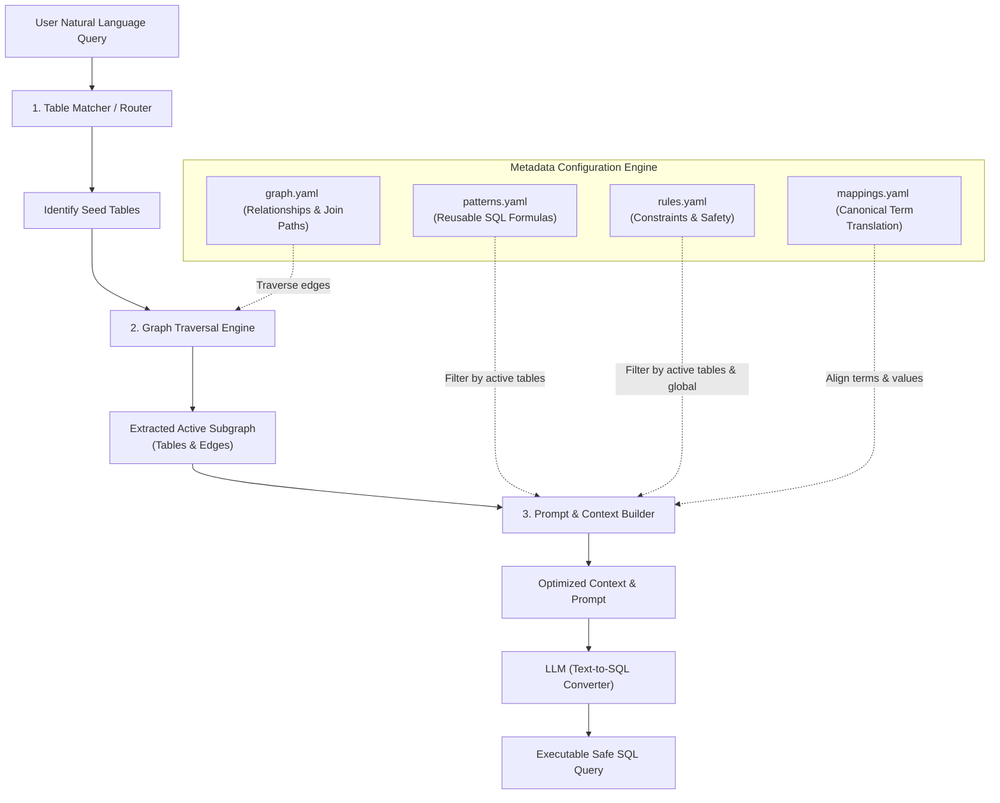

# Semantic Query Engine: Metadata-Driven Configuration Guide

In modern AI-powered semantic query engines (Text-to-SQL systems), translating a natural language question into correct, safe, and performant SQL is a complex task. Relying solely on raw LLM intelligence or static schemas often leads to hallucinations, database timeouts, security leaks, or invalid business calculations.

To solve this, a **metadata-driven semantic architecture** uses declarative configuration files—**`graph.yaml`**, **`patterns.yaml`**, **`rules.yaml`**, and **`mappings.yaml`**—to dynamically shape the context (schemas, joins, rules, and formulas) fed into the LLM. 

This guide describes the significance, purpose, and structure of these four configuration layers in a generalized manner.

---

## 🗺️ Architectural Overview

The engine operates as a declarative pipeline. When a user asks a question, the configuration files act as filters and enhancers to assemble a hyper-relevant, safe prompt for the LLM:



---

## 1. `graph.yaml` (The Schema Traversal & Relationship Layer)

### 📌 Significance & Purpose
In large relational databases, sending the entire schema to an LLM wastes token bandwidth and triggers cognitive overload, leading to bad schema selections. `graph.yaml` defines the database as a **directed/undirected semantic graph** where:
*   **Nodes** are the database tables.
*   **Edges** are semantic join paths and relationships.

When a query is initialized, the traversal engine starts at the "seed tables" (matched by the query terms) and traverses only relevant edges up to a specified depth. This pulls in related tables and exact JOIN syntax dynamically.

### 🔑 Key Concepts & Fields
*   **`from` / `to`**: Defines the source and target nodes (tables).
*   **`via`**: Specifies the join keys (`left` column and `right` column).
*   **`scoped`**: Ensures tenant isolation (e.g., both tables must match on `facility_id` or `tenant_id` to prevent cross-contamination).
*   **`weight`**: Relevancy score (0.0 to 1.0) defining how likely the relationship is needed. High-weight edges are traversed automatically; low-weight ones are only traversed if explicitly requested.
*   **`when`**: Human-readable context triggers detailing *why* this join path exists, assisting in query routing.
*   **`extra_conditions`**: Static SQL clauses needed to make the join correct (e.g., hardcoded type checks or active record flags).

### 📄 Generalized Schema Example
```yaml
edges:
  - from: patients
    to: billing_claims
    via: { left: mrn, right: patient_mrn }
    scoped: [tenant_id]
    weight: 0.8
    when: "calculating revenue per patient, insurance claims, or individual billing status"

  - from: patients
    to: entity_mappings
    via: { left: referrer_name, right: source_value }
    extra_conditions: "em.source_system = 'emr' AND em.entity_type = 'referrer'"
    weight: 0.6
    when: "resolving external referral names to system IDs"
```

---

## 2. `patterns.yaml` (The Reusable Calculation & Formatting Layer)

### 📌 Significance & Purpose
LLMs are notoriously inconsistent at generating complex mathematical formulas, date truncations, and specialized aggregates (e.g., active census count, length of stay, or attendance rates) from scratch. 

`patterns.yaml` abstracts these calculations into **pre-verified, modular SQL fragments**. By keeping the formula out of the LLM's imagination, you guarantee mathematical consistency and standardization. If a table in the traversed subgraph has associated patterns, those patterns are injected directly into the prompt as a "cheat sheet".

### 🔑 Key Concepts & Fields
*   **`applies_to`**: Denotes the list of tables to which this formula applies. The engine only loads the pattern if one of these tables is active.
*   **`formula`**: The raw, pre-verified SQL snippet or expression.
*   **`alias`**: The standardized business column name (e.g., `Length of Stay (Days)`).
*   **`description`**: Explains when, how, and why the LLM should substitute this formula in place of standard aggregations.

### 📄 Generalized Schema Example
```yaml
patterns:
  length_of_stay:
    applies_to: [patients]
    formula: "EXTRACT(EPOCH FROM (discharge_date - admission_date)) / 86400.0"
    alias: "LOS (Days)"
    description: "Computes stay length in days. Only apply when discharge_date IS NOT NULL."

  dollar_format:
    applies_to: [billing_claims, payments, marketing_spend]
    formula: "TO_CHAR(amount::NUMERIC, 'FM$999,999,990.00')"
    description: "Standard financial currency formatting. Apply to all final output dollar values."
```

---

## 3. `rules.yaml` (The Domain Constraints & Safety Layer)

### 📌 Significance & Purpose
Every operational system has quirks: encrypted database fields, legacy columns, deprecated states, data gaps, or clinical thresholds that are not apparent in a raw database schema. 

`rules.yaml` serves as the **guardrails and domain knowledge repository**. It translates developer instructions, institutional constraints, and database gotchas into structured rules. These rules are injected dynamically based on the active tables in the traversed subgraph, preventing database errors and data leaks.

### 🔑 Key Rule Categories
*   **`usage_rule`**: Strict structural boundaries ("never select column X", "always filter out test accounts", "always use exact matches for column Y").
*   **`data_note`**: Contextual awareness concerning completeness or availability ("this table only contains data for department 3", "70% of rows lack a value here").
*   **`schema_quirk`**: Corrects non-intuitive database anomalies ("table `users` has a column `full_name` but lacks `first_name`").
*   **`clinical_reference` / `domain_reference`**: Specialized operational metrics or thresholds (e.g., abnormal vital signs, severity index cutoffs).

### 📄 Generalized Schema Example
```yaml
rules:
  - type: usage_rule
    table: patients
    column: ssn_encrypted
    rule: "NEVER SELECT or display this column to users under any circumstance"
    reason: "Contains raw PII; violating this causes security leakage"

  - type: usage_rule
    table: patients
    rule: "Always filter out test records and inactive profiles"
    action: "Every user count or profile query must include: AND is_test_account = FALSE AND status != 'pending'"

  - type: schema_quirk
    table: users
    rule: "Columns first_name and last_name DO NOT exist"
    action: "Use full_name and split it programmatically if necessary"
```

---

## 4. `mappings.yaml` (The Canonical Translation & Alignment Layer)

### 📌 Significance & Purpose
Users speak in casual abbreviations and colloquial terms (e.g., "RTC", "Detox", "inpatient"), whereas EMRs and contracts may record values with precise prefixes (e.g., `"UR LOC: Residential Care"`, `"DTX-09"`). 

`mappings.yaml` acts as a **synonym matrix and translation dictionary**. It maps human terminology to EMR representation codes and insurance contract values. The query engine uses these mappings to dynamically align user intent with exact database constraints without requiring the LLM to guess the value mappings.

### 🔑 Key Concepts & Fields
*   **`canonical`**: The master label representing the concept.
*   **`abbreviation`**: The standard shortened form.
*   **`kipu_pattern` / `emr_pattern`**: The wildcard SQL string needed to match EMR database values.
*   **`insurance_value` / `system_value`**: The exact code recorded in transactional or billing systems.
*   **`user_terms`**: Synonyms, typos, and phrases a user might type that map to this item.

### 📄 Generalized Schema Example
```yaml
levels:
  - canonical: Residential
    abbreviation: RTC
    emr_pattern: "%Residential%"
    insurance_value: RTC
    user_terms: [residential, RTC, res, inpatient]

  - canonical: Detox
    abbreviation: DTX
    emr_pattern: "%Detox%"
    insurance_value: Detox
    user_terms: [detox, DTX, detoxification, weaning]
```

---

## 💡 Architectural Advantages of this Meta-Driven Design

| Feature | Hardcoded Translation | LLM "Zero-Shot" Guessing | Metadata-Driven Engine (YAMLs) |
| :--- | :--- | :--- | :--- |
| **Accuracy & Precision** | 🔴 Low (inflexible, breaks on variation) | 🟡 Medium (prone to hallucinating columns/joins) | 🟢 **High** (precise join paths & formulas injected) |
| **Token Utilization** | 🟢 Minimal | 🔴 Extremely High (must load full schema & rules) | 🟢 **Optimal** (loads only active subgraph & relevant rules) |
| **Maintainability** | 🔴 Nightmare (editing python code for schema changes) | 🟡 Medium (system prompts become bloated) | 🟢 **Excellent** (changes require updating simple YAML files) |
| **Security Guardrails** | 🟡 Medium (manual logic guards) | 🔴 Low (LLMs easily bypass text guidelines) | 🟢 **Robust** (rules automatically parsed & strictly injected) |

By segregating relationships (`graph.yaml`), formulas (`patterns.yaml`), constraints (`rules.yaml`), and translations (`mappings.yaml`) from the core application codebase, the engine remains lightweight, adaptable to database schema migrations, and exceptionally accurate.
